# Hey, I'm Leggit 👋

Self-taught developer from **Fuvahmulah, Maldives** 🇲🇻, building with Laravel since v4.2.

I build backend APIs, admin panels and mobile apps, mostly for councils, local businesses and civic tech here in the Maldives.

### 🛠️ Stack

### 🚧 What I work on
- 🏛️ Council & government systems: land management, case management, meeting governance
- ⚡ Realtime infrastructure with Laravel Reverb
- 📦 [composer-store](https://github.com/wuemv/composer-store): a pnpm-style global package store for Composer
- 🗺️ Self-hosted map tiles for the Maldives

### 📫 Find me
- 🌐 [wue.mv](https://wue.mv)
- 💼 [LinkedIn](https://linkedin.com/in/leggit)
- ✉️ leggit@wue.mv

